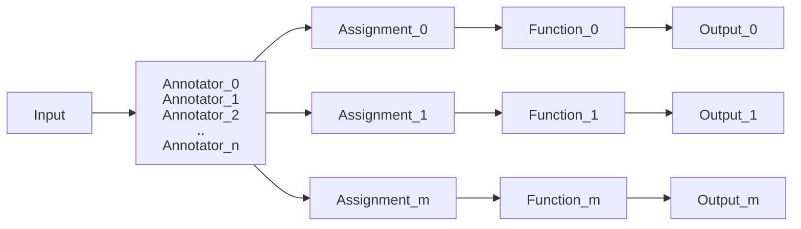
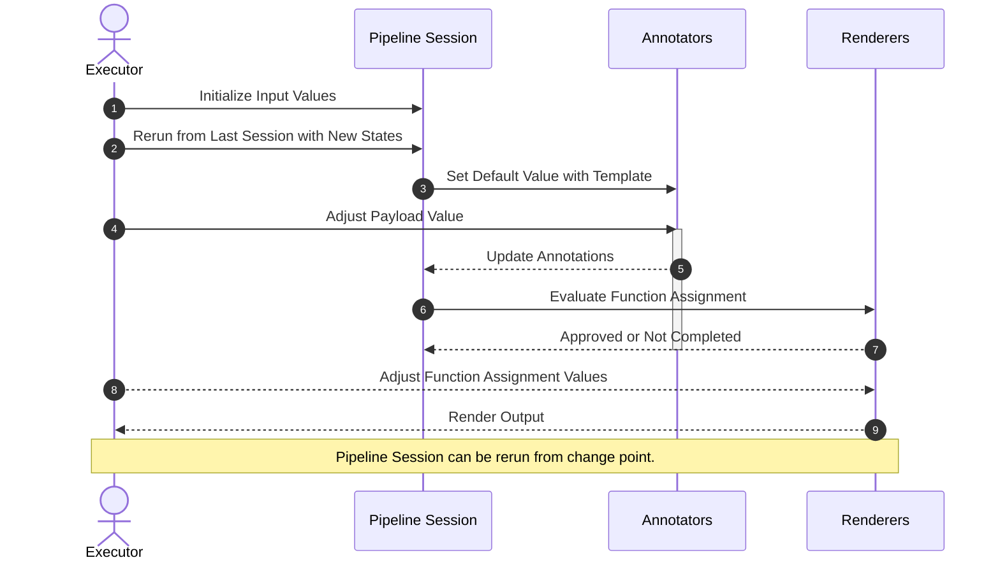

# Complex Template Framework

## 1. Complex Template Framework

### 1. Simple Template as Functions

**Template Types**:
- FreeMarker
- Mustache/Handlebars
- Groovy
- Python
- JavaScript
- Kotlin
- Other Scripts

**Template Schema Type**:
- JsonSchema
- Json
- Yaml
- XSD

**Template Input (Structured Data Format)**
- json
- yaml
- xml
- structured-markdown

**Template Output Type**
- Text based output: doc, code(sql, python, java...), story
- Diagram
- Multimedia: image, video, audio...
- AI Prompt

**Template Packages**
- A template package group a set of related template functions of same domain
- A template package saved as a markdown file in special format
- Template packages can be saved and indexed as long-term memory: Template Repository

**How to Create and Manage Template Functions/Packages**
- Manually create based on sample works
- Though AI Chatbot through prompt engineering
- Training from existing resources: books, user guides, existing works...
- REST API for creating, updating, search and managing template functions/packages, including generating template functions/packages through chatbot and prompt templates.
- MCP server is build on the top of REST API for agent tools
- AI Agents for generating template packages/functions through reading different resources, save to function repositories, and build into RAG Vector DB and LLM Wiki System

### 2. Introduce Annotators into the Scene

### 3. Multiple Template Functions and Outputs

### 4. Template Pipelines

**Template Pipeline**
- Template Pipeline Session: 
- Template Input Parameters: 
- Template Annotators: 
- Template Renderers: 

**Template Pipeline Session**
- When pipeline crate an instance, it starts a session to host input parameters value and states that updated by annotators
- Pipeline defines input schema. When a session is created, initial parameter values need to be provided to start the session
- Which pipeline instance run finished, the session state is recorded (in a markdown file). User can manually annotate the failed point (annotator) with correct value or annotating logic, and trigger next run.

**Template Annotators**
- Annotators works in sequence to provide all required information to run the template functions
- Each Annotator host a state attribute in session called TemplateAnnotation. Annotator should provide the schema of the Annotation, which will be used by other annotator or renderers' function assignment.
- Annotator can use template to create default value from input values and current state of session.
- Each annotation contains annotation format and annotation body. Annotation body can be initialized with default value generated by its template
- Annotator contains a processor which generate annotation value based on annotation format and body (transform, construct, call external API or prompt AI)
- If annotator fails, it stops the session and save the error message to annotation's message field.

**Template Renderer**
- A template renderer consists of a template function and template function assignment.
- Template function can be defined and reused in the scope of pipeline or import from reusable template packages
- The template function assignments ingest and transform related data from session based on mapping scripts such as expression language, jsonPath.

**Pipeline Input and Output**
- Each Template Pipeline should define an input schema to normalize input
- Each Pipeline instance execution loop will record its process state and results in a markdown file. If failed, user can update the settings, annotation or assignment, and rerun the pipeline until successfully.
- The output of the pipeline execution can be included in the markdown file (by default), or written to the local file system or update to other destinations such as database, cloud storage depending on the renderer settings.

**Pipeline Processing Mode**
- With human interaction
- Without human interaction

### 4. Orchestration: Multiple Template Pipelines Working Together

### 5. AI Powered
- Generate Template Function with AI
- Generate Template Function Package with AI
- Create Normalized Requirements for Generating Template Function Package with AI

## Executable Markdown

1. Markdown is flatten AST, Executable Markdown(ExMD) can be parsed as tree-like AST by using Heading and Link;
2. ExMD files start with metadata block to declare executable component (template, schema, annotator, generator...) and index/search metadata (tags, metadata...);
3. ExMD files use FencedCodeBlock to define executable components, which usually provide information about format, contentBody, optionally provide additional information such as name, properties...
4. ExMD files use special markdown and html code block to describe the whole markdown and each of the components. Such descriptions can be easily chunked in RAG process
5. When an ExMD file is executed, the results of each components, such as data, file contents, tables, images etc. can also be displayed in the same file, but will not be stored and effect next execution.

## Functions and Packages

